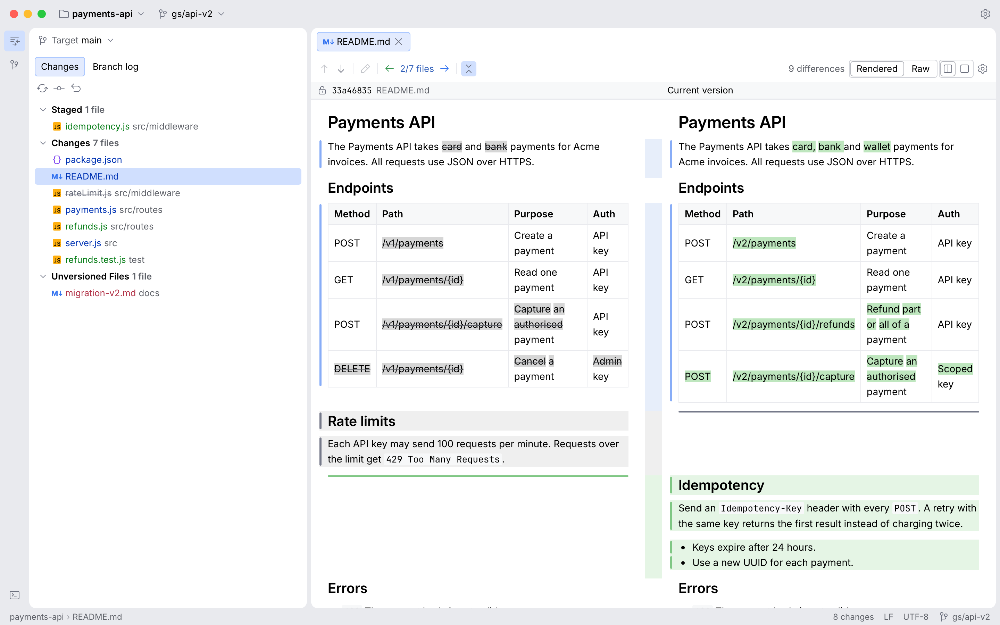

# Diffloupe

Diffloupe is a Mac app for reviewing git changes. Pick the branch you work on and a target branch, and it shows every change between them: side-by-side and unified diffs with changed words marked, the branch's commit history, rendered Markdown diffs, a 3-pane merge window, commit and push, and a terminal. Your code stays on your Mac.



## Install

On a Mac with Apple silicon and macOS 13 or later, paste this into Terminal:

```bash
curl -fsSL https://diffloupe.com/install.sh | bash
```

The command downloads the latest release, checks its SHA-256 checksum and puts Diffloupe in your Applications folder, or in `~/Applications` when you cannot write to `/Applications`. You can read the script first at https://diffloupe.com/install.sh. You can also download the disk image from the [Releases](https://github.com/brisote/diff-loupe/releases) page; https://diffloupe.com/download/ explains its first start.

## License

Diffloupe's source is published under the [PolyForm Internal Use License 1.0.0](LICENSE), with one added permission. You may use Diffloupe at no cost for your own or your company's work, and for personal, educational and evaluation use. You may change it for those purposes. You may not share copies of it, sell it, or offer it to others. [NOTICE](NOTICE) lists the bundled fonts and icons and their own licenses.

## Contributing

Bug reports and ideas are welcome in [Issues](https://github.com/brisote/diff-loupe/issues). To build Diffloupe or send a change, read [CONTRIBUTING.md](CONTRIBUTING.md). Report security problems privately, as [SECURITY.md](SECURITY.md) explains.
